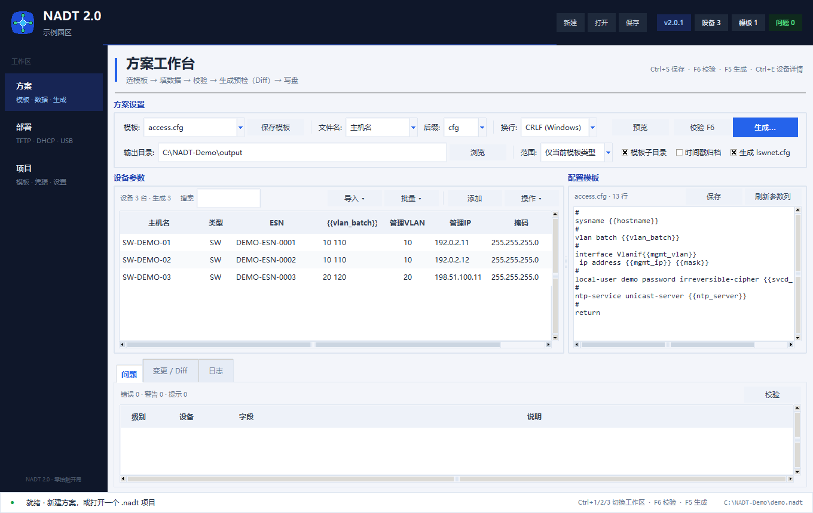

<div align="center">


# NADT Network Automation Deployment Tool

**Vendor-neutral zero-touch provisioning for network switches (ZTP) — DHCP option 66/67 + TFTP (Huawei / Cisco / generic presets).**

<sub>[**English**](README.md) · [**简体中文**](README.zh-CN.md) · [**User guide**](docs/USER_GUIDE.md)</sub>

<a href="../../releases/latest"></a>


<a href="https://github.com/Yata-Datacom/NADT-Network-Automation-Deployment-Tool/actions/workflows/ci.yml"></a>
<a href="https://github.com/Yata-Datacom/NADT-Network-Automation-Deployment-Tool/actions/workflows/build.yml"></a>

</div>

> A provisioning workbench for network engineers: one `.nadt` project file holds devices, templates, credentials
> and generation settings; one Plan page takes you from template → data → validation → diff → generate → deploy.

> ⚠️ **PREVIEW** — this tool is still being refined (some UI and docs still need polish, a few scenarios are not covered yet);
> it is published early for trial and reference. **Current version v2.0.1 (preview)** — feedback welcome.
>
> Before use, please: ① replace the sample passwords/credentials in the device list with your own; ② validate in a lab before production.

**NADT 2.0 is a full rewrite**: from “tabs + global device database” to **project files + a plan workspace +
validation/diff + credential protection**. The 1.x Excel-macro workflow, TFTP, DHCP and USB packaging remain,
and existing xlsm workbooks can be imported in one click.

- **Project file** — `.nadt` = devices + templates + type map + credentials + generation settings + last manifest
- **Plan workspace** — grid columns derived from template placeholders; Excel-range paste, inline edit,
  fill/sequence, find & replace
- **Validation + diff** — `F6` validation with click-to-jump; preflight shows added/changed/unchanged files and
  a per-file unified diff before anything is written
- **Credential protection** — project credentials encrypted with Windows DPAPI (current user); masked in UI and diff
- **Deployment tools** — TFTP server, DHCP option 66/67 snippets and EasyDeploy USB package for the current project

**v2.0.1** · [CHANGELOG](CHANGELOG.md) · [User guide](docs/USER_GUIDE.md) · [Development & Tests](#-development--tests)

<p align="center">
  
</p>

---

## ⬇️ Download

Download the single-file Windows exe from
[Releases](https://github.com/Yata-Datacom/NADT-Network-Automation-Deployment-Tool/releases) — no install, no Python required.

### 📖 Documentation

- [User guide (English)](docs/USER_GUIDE.md) — install, project files, Plan, validation/diff, Deploy, shortcuts, troubleshooting
- [使用指南（中文）](docs/USER_GUIDE.zh-CN.md)
- [CHANGELOG](CHANGELOG.md) — what changed in 2.0 / 2.0.1

---

## 🧭 Overview

### What it does

NADT mass-provisions switches over the network, without ever touching a console:

1. A brand-new switch boots and gets an address from your DHCP server.
2. The DHCP reply carries option 66/67 (`tftp-server-name` / `bootfile-name`) pointing at your TFTP server.
3. The switch downloads **its own** `.cfg` (rendered per device from your template), applies it — and the
   management IP, VLANs, accounts and services are all in place.

The core engine is **vendor-neutral**: a device list + a `{{placeholder}}` template renderer + `.cfg` generation.
Vendors are only presets:

| Preset | Bootstrap file | ESN mapping | DHCP output |
| :-- | :-- | :-- | :-- |
| **Generic** (recommended) | — | bound by MAC | ISC dhcpd / dnsmasq |
| **Huawei** | `lswnet.cfg` | ✅ EasyDeploy | Huawei VRP option 146 |
| **Cisco** | `network-confg` | — bound by MAC | ISC dhcpd / dnsmasq |

Adding a vendor = one entry in `VENDOR_PRESETS`; the engine stays untouched. The renderer is not
vendor-specific either: any text config (VRP / IOS / XR / NX-OS / …) works with `{{variables}}`.

### Requirements

- Python 3.10+ (tested on Windows)
- Core is standard-library only; `openpyxl` is optional — needed just for the Excel workbench and
  template import: `pip install -e ".[excel]"`

### Quick start

```bash
python -m pip install -e ".[excel]"
python nadt2.py           # NADT 2.0 UI; console entry points: nadt2 / nadt
```

…or simply grab the single-file exe from [Releases](https://github.com/Yata-Datacom/NADT-Network-Automation-Deployment-Tool/releases)
(Windows, no Python required).

1. New/open a `.nadt` project (`Ctrl+N` / `Ctrl+O`; click **Import legacy workbook** for an xlsm)
2. On **Plan**, pick a template and fill the grid (double-click, or `Ctrl+V` an Excel range)
3. `F6` validate; double-click a problem to jump to the device/field
4. Choose filename rule / extension / output folder, click **Generate…**, review the per-file diff, write
5. Switch to **Deploy**: start TFTP, generate DHCP, build the USB package

The legacy 1.x UI is still available: `python nadt.py` (or the `nadt1` command).

### Notes

- This is a **preview** release — please validate in a lab before production use.
- Replace the sample credentials in the device list and templates with your own first.
- **Privacy:** do not commit real `.nadt` project files, device lists, screenshots or credentials to a public
  repository. The screenshots in this repository use synthetic demo data.
- In-depth docs (Excel template import, USB ZTP package, `lswnet.cfg` version files, DHCP modes,
  thousands-of-devices scale) are in the sections below.

---

## 🏭 Vendor-neutral by design

The NADT core engine is vendor-neutral (device list + template rendering + cfg generation); Huawei is just one of the presets:

| Preset | Bootstrap file | ESN mapping | DHCP output |
| :-- | :-- | :-- | :-- |
| **Generic** (recommended) | — | ❌ bound by MAC | ISC dhcpd / dnsmasq |
| **Huawei** | `lswnet.cfg` | ✅ EasyDeploy | Huawei VRP option 146 |
| **Cisco** | `network-confg` | ❌ bound by MAC | ISC dhcpd / dnsmasq |

- Picking a preset on tab ③ fills the parameters in automatically, and **every one of them can be overridden by hand** (bootstrap file name, mapping-table toggle)
- Generic mode: DHCP binds each device's own cfg by MAC (`option bootfile-name "主机名.cfg"`) — that is how Cisco auto-install works
- Huawei mode: ESN mapping table lswnet.cfg + option 146 netfile — the EasyDeploy-specific way
- Adding a vendor = one entry in `VENDOR_PRESETS`; the core engine does not have to change
- The template engine is vendor-agnostic: any text config (VRP/IOS/XR/NX-OS/…) can be rendered with `{{变量}}`

---

## 🆕 NADT 2.0 workflow

Three workspaces in the left rail:

| Workspace | Purpose |
| :-- | :-- |
| **Plan** | template → data grid → validate → preflight diff → write |
| **Deploy** | TFTP server, DHCP option 66/67, EasyDeploy USB package |
| **Project** | project info, template library, credentials, variables, settings, recent projects |

### Project file `.nadt`

One `.nadt` file is a complete plan (readable JSON, easy to back up):

- device list, including extended fields
- every template text plus the type → template map
- project variables and credentials (credentials are encrypted with **Windows DPAPI, current user** by default)
- generation settings (filename rule, extension, output, CRLF/LF, lswnet, scope)
- the last generation directory/file manifest (used for diff and continuation)

Saves are atomic (temp file + `os.replace`) and keep a `.bak`; an `.autosave` recovery copy is written every
60 seconds when enabled. DPAPI credentials cannot be decrypted by another user/machine — re-enter them there.

### Validation / jump to problem

- `F6`: duplicate hostnames/ESNs, missing template variables, filename collisions, empty credentials, invalid extension
- errors/warnings/info; double-click a row to jump to the device and field (switching back to “all devices” if needed)
- generation re-validates; errors block by default, with an explicit “generate anyway” escape hatch

### Preflight diff

- builds a generation plan (nothing written), with added/changed/unchanged/error counts
- file list on the left, per-file unified diff on the right; sensitive values are masked unless toggled
- write only after confirmation; unchanged files are not rewritten; the “Changes / Diff” tab keeps the result

### Batch operations

- fill value, numeric sequence (start/step/padding/prefix/suffix)
- duplicate rows (creates `-copy` hostnames and clears ESN to prevent accidental provisioning)
- find & replace (regex/case options)
- CSV/Excel import with column → template-parameter mapping (standard fields auto-matched)

### Credentials and project variables

- **Credentials**: `svcd_password`, `enable_secret`, … — reference them as `{{svcd_password}}`
- **Variables**: `site`, `ntp_server`, … non-sensitive project defaults
- device extended fields override project variables/credentials for one-off cases
- preview, diff and logs mask them by default; the Project page can temporarily reveal values

---

## 📋 Device list format (CSV, header row first)

```csv
esn,hostname,type,mgmt_ip,mgmt_vlan,access_vlan,mask,gateway,note
[SN],SW-1F-01,ACCESS,10.10.10.1,10,20,,,1F弱电井
```

| Field | Description |
| :-- | :-- |
| esn | Device serial number (Huawei `display esn` / chassis label) |
| hostname | Device name; also the generated cfg file name |
| type | **Free text**, only used to pick a template via the type→template mapping (e.g. ACCESS/CORE); never derived |
| mgmt_ip | Management IP |
| mgmt_vlan / access_vlan | **Required** when the template uses vlan_batch; left empty while the template still references them it errors out |
| mask / gateway | Mask defaults to 255.255.255.0; an empty gateway defaults to .254 of the management subnet |

> Extra columns are free: any column name becomes a template `{{变量}}` / `{{variables}}` (see the template language section below).

**💡 Batch numbering**: hostnames / management IPs / ESNs / extended fields support `{范围}` range syntax, generating many devices in one go:

| Pattern | Expands to |
| :-- | :-- |
| `SW-{1-254}` | SW-1 … SW-254 (254 devices, in order) |
| `SW-{1,254}` | only SW-1 and SW-254 (2 devices) |
| `SW-{01-03}` | SW-01, SW-02, SW-03 (zero-padded) |
| `10.10.10.{1-3}` | 10.10.10.1 … .3 |

Multi-field patterns map one-to-one: `SW-{1-3}` + management IPs `10.10.10.{1-3}` → SW-1↔.1, SW-2↔.2, SW-3↔.3.
Generating more than 20 devices asks for confirmation first; more than 500 is refused (please add them in batches).

**🔍 Search and paging**: the device table supports keyword search (ESN/hostname/IP/type, case-insensitive) and paging
(100/200/500/1000 rows per page, pager in the bottom-right corner), so even several thousand devices stay responsive.

**✅ Batch validation**: click **Validate**, or let the pre-generation check run automatically — duplicate ESN/IP/hostname,
malformed IPs and missing required fields are errors, a missing ESN is a warning. When errors exist, generation asks for
confirmation first, so you never bring switches up with conflicting data.

**💾 Local device library**: the device list is saved automatically to `devices.db` (SQLite) and restored when the app is
reopened; CSV/Excel import and export keep working, and `devices.db` can be deleted at any time (it is rebuilt on the next add).

**↶ Undo**: the **↶ Undo** toolbar button or Ctrl+Z rolls back a mistaken delete/edit/clear, up to 20 steps.

**📦 Auto-archive on generate**: by default each run is written to a `输出目录/时间戳/` subdirectory with the last 10 runs
kept automatically; untick **Auto-archive** to write straight into the chosen directory.

**🏁 TFTP deployment checklist**: tab ④ shows "已开局 N 台" (N switches up) live; **Generate deployment list** writes
`deployed_report.txt` (time / file name / client IP plus the ESN and type looked up from the device list);
**Reset record** clears the counters before a new batch.

---

## 📥 Excel template import (beyond macro scripts)

Supports the **Excel macro workflow** field engineers already use (xlsm template-library format: a template sheet +
parameter columns + one device per row):
- Tab ① **Import Excel template** → pick an xlsm/xlsx file
- Recognition rules: each sheet is one template (A1 holds the template name, or column A contains `{{变量}}`):
  - **Column A, from row 2** = config template text (`#` separator lines are kept)
  - **Row 1, from column C** = parameter names (`{{sysname}}`)
  - **Every row from row 2** = one device (its parameter values)
- After import: templates go into the ② template library (type = sheet name, mapped automatically), devices go into the
  ① list (parameters become extended fields); just generate on ③ — **no VBA macro needed any more**
- Non-template sheets such as 主页/模板数据/帮助说明 are skipped automatically

**Column-mapping import**: **Import CSV/Excel** first opens a column-mapping window (headers are auto-detected; you can
map any column to hostname/IP/type/ignore/extended field by hand), so non-standard headers still import.

**Generate Excel template**: tab ① **Generate Excel template** → saves an xlsx: sheet1 示例模板
(column A config text + parameter names + 3 sample devices — edit it and it is ready to use), sheet2 操作方式
(structure/steps/variable syntax/caveats). Once filled in, click **Import Excel template** to import it.

⚠ After importing, run **Validate** first: same-named devices across sheets and misspelled template variables (e.g. the
old macro's `{{vlaif1004}}` versus the parameter `vlanif1004`) are listed explicitly — in the macro era these errors were silent.

**Extended fields**: one `K:V` per line (Enter-separated), with `=` / `:` / `：` accepted as the separator, Chinese keys
included; any K becomes a template `{{K}}` (for example `ntp_server:10.0.0.1` → `{{ntp_server}}`).

---

## 🧩 Template placeholders & language

**Variable placeholders**: `{{hostname}}` `{{vlan_batch}}` `{{mgmt_vlan}}` `{{mgmt_ip}}` `{{mask}}` `{{access_vlan}}` `{{gateway}}`
**Any variable**: **extra columns** in the device-list CSV, or `key=value` pairs in a device's "extended fields", all become
template variables (e.g. the column `ntp_server` → write `{{ntp_server}}` in the template).

**Template directives** (so even complex templates stay precise at scale):

| Directive | Notes | Example |
| :-- | :-- | :-- |
| `{{#if 变量}}` ... `{{#else}}` ... `{{#endif}}` | conditional block, emitted only when the variable is non-empty | add NTP config only when NTP is set |
| `{{#if 变量=值}}` | conditional equals | `{{#if type=CORE}}` |
| `{{#for n from 1 to N}}` ... `{{#endfor}}` | loop, N may itself be a variable | generate 24/48 interface blocks |

```cfg
# Example: the 24/48 ports are driven by the device extended field port_count
{{#for n from 1 to {{port_count}}}}
interface GigabitEthernet0/0/{{n}}
 port link-type access
 port default vlan {{access_vlan}}
#
{{#endfor}}
```

**Template library**: put multiple `.cfg` templates in the `templates/` directory; tab ② switches between, creates and deletes them.
**Type→template mapping** (`templates/mapping.json`): the type field is free-form (ACCESS / CORE / anything project-specific) —
map types to templates on tab ② and generation picks the right template by type.

Template file: `templates/access-switch.cfg` (the default template, extracted from a real campus access-switch deployment
config (**sanitised**: change the sample passwords before deploying))

---

## 🔧 How it works

```text
[DHCP provisioning (generic)] device boots → DHCP (option 66 = file server, option 67 = boot file)
          → download config → apply → provisioning done
          Generic/Cisco: DHCP binds by MAC, each device fetches its own hostname.cfg
          Huawei:       downloads the lswnet.cfg ESN mapping table, finds its own cfg by serial number

[USB-stick ZTP (Huawei EasyDeploy)] works with no DHCP at all:
          generate usb_config.ini (EasyDeploy format) → copy to the USB root
          → insert into the switch and power on → match the [DEVICEn DESCRIPTION] block by ESN/MAC
          → load SYSTEM-CONFIG from the USB stick (file:/usb:) → provisioning done
```

---

## 💾 EasyDeploy USB package

Tab ③ **Generate USB ZTP package** → writes `usb_config.ini` plus every `.cfg` into `输出目录/usb/`:

```ini
;BEGIN DC
[GLOBAL CONFIG]
FILESERVER=file:/usb:
[DEVICE0 DESCRIPTION]
ESN=[SN]
DEVICETYPE=DEFAULT
SYSTEM-SOFTWARE=[SOFTWARE].cc   ; optional, ③-page SYSTEM-SOFTWARE default
SYSTEM-CONFIG=[HOSTNAME].cfg       ; taken from the device hostname
SYSTEM-PAT=[PATCH].PAT           ; optional
STACK-MEMBER-ID=2                                ; stacking: extended field stack_member_id
;END DC
```

- One `[DEVICEn DESCRIPTION]` block per device (n starts at 0), matched by ESN; devices without an ESN use MAC (add a mac column to the device list)
- Stacked devices: put the member id in the extended field, `stack_member_id=成员ID` (add one row per member to the list — same config, different ESN/member id)
- With no DHCP, keep FILESERVER as `file:/usb:`; FILESERVER can also hold an ftp/sftp/tftp address to go over the network
- usb_config.ini uses CRLF line endings (Huawei requires it); the file must be named `usb_config.ini` and live in the USB **root directory**

---

## 📦 lswnet.cfg version file & patch (complex scenarios)

Real-world format (core switches flashing a version plus a patch in one go):

```text
esn=[SN];vrpfile=[SOFTWARE].cc;patchfile=[PATCH].pat;cfgfile=[HOSTNAME].cfg;
```

- Tab ③ **lswnet version file vrpfile / patch patchfile** sets the global default; leave it empty to omit that field
- The device extended fields `vrp_file` / `patch_file` override it for a single device
- The device-list CSV can also carry vrp_file / patch_file columns directly

---

## 🔌 DHCP modes (⑤ deployment notes)

- **Mode 146 (Huawei EasyDeploy standard, default)**:
  `option 66 ascii sftp://user:pass@ip:port` + `option 146 ascii opervalue=1;delaytime=0;netfile=lswnet.cfg;`
- **Mode 67 (generic PXE)**: `option 66 ip-address IP` + `option 67 ascii lswnet.cfg`
- Huawei S-series switches' EasyDeploy only understands **option 146**; other vendors (or a generic DHCP server) use 67

---

## 🏗 Large-scale (thousands of switches)

| Capability | Notes |
| :-- | :-- |
| **Asyncio TFTP engine** | asyncio single event loop, 1000+ concurrent transfers (vs. thread-per-request); prewarmed in-memory cache (falls back to on-demand above 200 MB total) |
| **Concurrency cap** | Adjustable on the TFTP tab (default 500); over-limit clients are rejected and told to retry, so a thundering herd after a power event cannot crush the server |
| **Parallel generation** | Multi-threaded rendering with live N/total progress; failures are summarised into `failures.csv` |
| **Batch validation** | Pre-generation duplicate ESN/IP/hostname checks to rule out thousand-switch incidents |
| **Device library persistence** | SQLite storage survives restarts; search and paging keep large device lists workable |
| **Incremental rollout advice** | At thousand-device scale: point DHCP option 66 at several TFTP servers (round-robin), or stagger rollouts by floor/zone |

**Bottleneck note**: a single host's TFTP throughput is limited by its NIC bandwidth (a 100 Mbps port saturates at roughly
100 concurrent devices); for a thousand switches, round-robin option 66 across 2-3 servers, or provision in batches
(e.g. different DHCP scopes per building).

---

## 📦 Packaging

```bash
python -m PyInstaller --clean --noconfirm NADT.spec
# Output: dist/NADT 2.0.exe
# First run creates templates/ and output/ next to the exe
```

---

## ⚠️ Notes & caveats

- TFTP port 69 must be allowed through the firewall; the switch management network and the DHCP/TFTP hosts must reach each other
- Only for provisioning authorised devices — do not use it on unauthorised networks
- Legacy project: `C:\Users\yata\Documents\coding\批量交换机脚本生成\` (the Excel macro version)

---

## 🧪 Development & Tests

```bash
# Install (with dev dependencies: pytest / ruff / openpyxl)
python -m pip install -e ".[dev]"

# Run the tests (template engine / batch numbering / device validation / list parsing / DHCP / USB package)
python -m pytest -q

# Static checks
ruff check .

# Build the single-file exe (Windows)
python -m PyInstaller --clean --noconfirm NADT.spec
```

- Once installed you can also launch via the console entry point: `nadt`
- The core is standard-library only; `openpyxl` is an optional dependency (device-list xlsx / Excel template import-export) — when it is missing the UI warns instead of crashing
- CI: `.github/workflows/ci.yml` (pytest on Windows, ruff on Linux); `.github/workflows/build.yml` (tag push or manual trigger → exe artifact)
- The version number lives in **two** places, `pyproject.toml` and `nadt.__version__`, and they must match (a test guards it)

---

## ⚖️ License & disclaimer

| Item | Details |
| :-- | :-- |
| License | **MIT** — see [LICENSE](LICENSE) |
| Runtime | Python 3.10+ (see [pyproject.toml](pyproject.toml)), mainly validated on Windows |
| Status | **v2.0.1 Preview** — validate in a lab before production use |
| Scope | Only for provisioning authorised devices — do not use it on unauthorised networks |

**Topics:**


<div align="center">
<sub>MIT License · Yata-Datacom / NADT-Network-Automation-Deployment-Tool</sub>
</div>
