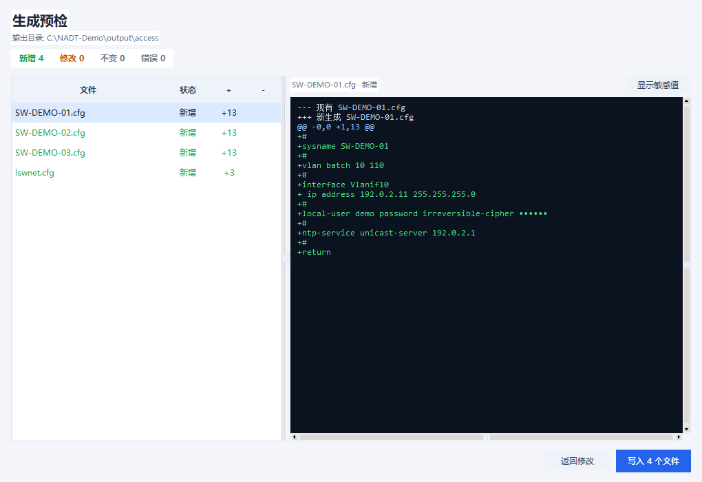
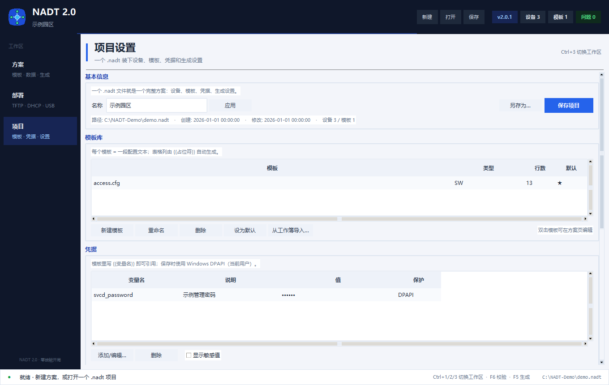

# NADT 2.0 使用指南

> 适用于 **NADT 2.0.1**。界面为中文，本文按界面上的实际按钮/菜单名说明。
> 截图中的 IP、ESN、口令均为示例，不是真实数据。

> **隐私提醒：** 不要把真实的 `.nadt` 项目文件、设备清单、截图或凭据提交到公开仓库。
> 本文截图全部使用合成的演示数据。

- [English user guide](USER_GUIDE.md)
- [README（中文）](../README.zh-CN.md) · [README（English）](../README.md)

---

## 1. NADT 是做什么的

NADT 把「一张设备表 + 一段配置模板」变成每台交换机自己的 `.cfg`，再配合 DHCP + TFTP 完成零接触开局：

1. 交换机上电，从 DHCP 获取地址；
2. DHCP option 66/67 指向 NADT 的 TFTP 服务器；
3. 交换机下载**自己的**配置（由 `{{占位符}}` 渲染）并应用。

NADT 2.0 在原有能力上增加了：项目文件、单屏方案工作台、校验、写盘前逐文件 Diff、批量编辑、
Windows DPAPI 凭据保护。

---

## 2. 安装与启动

### 方式 A：Windows exe

从 [Releases](https://github.com/Yata-Datacom/NADT-Network-Automation-Deployment-Tool/releases/latest) 下载 `NADT 2.0.exe`，放到可写目录，双击运行。无需安装 Python。

> exe 未签名，Windows SmartScreen 可能提示，请确认来源后继续。

### 方式 B：源码运行

要求：**Python 3.10+**，推荐 Windows。

```bash
git clone https://github.com/Yata-Datacom/NADT-Network-Automation-Deployment-Tool.git
cd NADT-Network-Automation-Deployment-Tool
python -m pip install -e ".[excel]"
python nadt2.py
```

安装后可用命令：

| 命令 | 启动 |
| :-- | :-- |
| `nadt2` / `nadt` | NADT 2.0 新界面 |
| `nadt1` / `python nadt.py` | 1.x 旧界面（兼容） |

`openpyxl` 是可选依赖，只有 Excel 导入/导出需要。

---

## 3. 第一个项目

1. 启动 NADT 2.0。
2. 点顶部 **新建**，或按 `Ctrl+N`。
3. 输入项目名称。
4. 点 **保存** 或按 `Ctrl+S`，选择 `.nadt` 文件位置。

一个 `.nadt` 就是完整方案：设备、模板、类型映射、项目变量、凭据、生成设置都在里面，JSON 可读。

- 保存是原子的，并自动保留 `.bak`；
- 会周期性写 `.autosave` 恢复副本；
- **项目 → 最近打开** 可快速回到最近项目；
- 打开项目时如果发现更新的 autosave，会询问是否恢复。


---

## 4. 方案工作台

### 4.1 选择模板

顶部 **模板** 下拉选择当前模板。**保存模板** 会把右侧编辑器内容写回项目。

模板就是普通文本，用 `{{占位符}}` 引用参数：

```text
#
sysname {{hostname}}
#
vlan batch {{vlan_batch}}
#
interface Vlanif{{mgmt_vlan}}
 ip address {{mgmt_ip}} {{mask}}
#
local-user svcd password irreversible-cipher {{svcd_password}}
#
return
```

常用占位符：

| 占位符 | 含义 |
| :-- | :-- |
| `{{hostname}}` | 主机名，也是默认文件名 |
| `{{sysname}}` | 一般与 hostname 相同 |
| `{{esn}}` | 序列号，`lswnet.cfg` 使用 |
| `{{mgmt_ip}}` / `{{mask}}` / `{{gateway}}` | 管理地址 |
| `{{mgmt_vlan}}` / `{{access_vlan}}` / `{{vlan_batch}}` | VLAN 参数 |
| `{{type}}` | 设备类型，多模板项目使用 |
| `{{note}}` | 备注 |

其他任意 `{{名字}}` 会自动成为模板参数。参数按以下顺序取值（后面的覆盖前面的）：

1. 设备标准字段
2. 项目变量
3. 项目凭据（同名时凭据覆盖变量）
4. 设备扩展字段

凭据和项目变量**不会**显示成表格列，它们是项目级默认值。需要单台覆盖时，打开
**设备详情（Ctrl+E）**，在扩展字段里写同名变量。

### 4.2 填写数据表

- 双击单元格编辑，`Enter` 提交，`Esc` 取消；
- 选中区域后 `Ctrl+V` 可粘贴 Excel/TSV；
- `Ctrl+C` 复制选中区域；
- `F2` 编辑当前单元格，`Delete` 清空；
- **搜索** 按主机名 / ESN / 管理 IP 过滤；
- **添加** 新增设备，**操作 ▾** 里是设备详情、复制、删除、预览。

表格列由当前模板自动生成。如果模板没有引用 `mgmt_ip`，该字段仍可在 **设备详情** 中维护，
DHCP / U 盘包也会使用它。

### 4.3 批量操作

设备工具栏 **批量 ▾**：

| 操作 | 用途 |
| :-- | :-- |
| 填充值 | 给选中/可见行的一列填同一个值 |
| 数字序列 | 按起始值、步长、补零、前后缀生成序列 |
| 复制选中行 | 复制行，主机名自动加 `-copy`，ESN 清空防止误开局 |
| 查找替换 | 支持正则、区分大小写 |
| 导入表格 | CSV/Excel 按列映射导入 |
| 删除选中行 | 删除选中设备 |

### 4.4 校验

按 `F6` 或点 **校验 F6**。NADT 会检查：

- 主机名重复、ESN 重复；
- 模板占位符没有值；
- 模板使用的凭据为空；
- 生成文件名冲突；
- 输出后缀不合法；
- 当前范围下没有目标设备。

结果在 **问题** 页。双击一行会跳到对应设备/字段；如果设备被当前范围隐藏，会自动切回「全部设备」。

### 4.5 预览与 Diff

点 **预览** 查看选中设备的最终配置；敏感值默认打码。

点 **生成…** 会先生成**计划**，不写盘：

- 左侧统计新增 / 修改 / 不变 / 错误；
- 左侧文件列表，右侧逐文件 unified diff；
- **显示敏感值** 可切换是否打码。

只有点 **写入 N 个文件** 才会真正写盘。未变化的文件不会重写；结果保留在 **变更 / Diff** 页。



### 4.6 输出设置

| 设置 | 说明 |
| :-- | :-- |
| 文件名 | 文件名规则：主机名、ESN、模板变量等 |
| 后缀 | 默认 `cfg` |
| 换行 | CRLF（Windows，默认）或 LF |
| 输出目录 | 相对路径按 `.nadt` 所在目录解析 |
| 范围 | 仅当前模板类型，或全部设备 |
| 模板子目录 | 输出到以模板名命名的子目录 |
| 时间戳归档 | 输出到时间戳子目录，保留历史 |
| 生成 lswnet.cfg | 生成华为 EasyDeploy ESN 映射表 |

---

## 5. 项目设置

打开 **项目**（`Ctrl+3`）。



### 5.1 基本信息

- 修改项目名称后点 **应用**；
- **保存项目** 写入 `.nadt`；
- **另存为…** 保存副本。

### 5.2 模板库

- **新建模板** 创建模板；
- **重命名** / **删除** 管理模板；
- **设为默认** 指定默认打开的模板；
- **从工作簿导入…** 从 xlsm/xlsx 导入模板；
- 双击模板可在方案页编辑。

### 5.3 凭据与项目变量

**凭据** 用于 `svcd_password`、`enable_secret` 等敏感值。

- 保存项目时使用 **Windows DPAPI（当前用户）** 加密；
- 列表里值显示为点，**显示敏感值** 可临时查看；
- 凭据不会以明文出现在表格、Diff、预览或日志里；
- 换 Windows 用户/换机器后 DPAPI 无法解密，属于预期行为，重新输入即可。

**项目变量** 用于 `ntp_server`、`site` 等非敏感默认值。单台设备需要不同值时，在
**设备详情** 里添加同名扩展字段。

### 5.4 设置

输出目录、文件名规则、后缀、换行、范围、lswnet、自动保存、敏感值打码等设置保存在项目文件里。

---

## 6. 部署

打开 **部署**（`Ctrl+2`）。

### 6.1 TFTP 服务器

1. 确认根目录（通常是生成输出目录）；
2. 端口默认 UDP `69`；
3. 点 **启动**，状态变为运行中，并显示本机 IPv4；
4. 在传输日志里查看请求；点 **停止** 结束服务。

注意：

- 69 是特权端口，绑定失败时可尝试以管理员身份运行；
- 放行 exe/Python 的 Windows 防火墙入站 UDP；
- 默认并发 500，可同时服务多台设备。

### 6.2 DHCP option 66/67

1. 填写 DHCP/TFTP 服务器 IP；
2. 选择 DHCP 风格：ISC dhcpd、dnsmasq、华为 VRP option 146 等；
3. 点生成，然后复制或保存片段；
4. 粘贴到真实 DHCP 服务器并 reload。

界面显示会打码。**复制** 会复制真实值到剪贴板，注意使用环境。

### 6.3 EasyDeploy U 盘包

1. 先完成配置生成；
2. 打开 **U 盘 ZTP**；
3. 选择 U 盘根目录（或使用默认 `output/usb`）；
4. 按需填写 SYSTEM-SOFTWARE / pattern；
5. 点生成。

NADT 会写 `usb_config.ini`，并把 `.cfg` 复制到 U 盘目录。

---

## 7. 导入旧 xlsm 工作簿

旧 1.x / 宏工作簿可以一键导入：

1. 设备工具栏 **导入 ▾ → 导入旧 xlsm 工作簿…**，或菜单 **项目 → 导入旧 xlsm 工作簿…**；
2. 选择工作簿；
3. NADT 识别模板 sheet（sheet 名=类型，A1 标题或 A 列含 `{{占位符}}`），导入模板、设备、参数和
   `lswnet` ESN 映射；
4. 先 **校验 F6**，再生成。

**导出 xlsm 兼容工作簿…** 可生成旧格式工作簿，方便仍在交换 Excel 的团队。

---

## 8. 快捷键

| 快捷键 | 功能 |
| :-- | :-- |
| `Ctrl+N` / `Ctrl+O` / `Ctrl+S` | 新建 / 打开 / 保存项目 |
| `Ctrl+Shift+S` | 另存为 |
| `Ctrl+1` / `Ctrl+2` / `Ctrl+3` | 方案 / 部署 / 项目 |
| `Ctrl+Z` / `Ctrl+Y` | 撤销 / 重做 |
| `F5` | 生成（预检） |
| `F6` | 校验 |
| `Ctrl+Enter` | 预览选中设备 |
| `Ctrl+E` | 设备详情（全部字段） |
| `Ctrl+F` | 聚焦设备搜索 |
| `Ctrl+H` | 查找替换 |
| `F2` | 编辑单元格 |
| `Ctrl+C` / `Ctrl+V` | 复制 / 粘贴选中区域 |
| `Delete` | 清空单元格 |

---

## 9. 常见问题

| 现象 | 排查 |
| :-- | :-- |
| TFTP 69 端口绑定失败 | 管理员运行；检查是否已有 TFTP 服务；放行防火墙 |
| 交换机不来下载配置 | 检查 DHCP option 66/67、TFTP IP 可达性、文件名和根目录 |
| 换机器后凭据为空 | DPAPI 绑定用户/机器，重新输入凭据 |
| 提示 `模板缺少变量` | 在设备、项目变量或凭据中补上；点「刷新参数列」 |
| 没有生成任何设备 | 检查「范围」和模板类型映射 |
| 输出路径不对 | 相对路径按 `.nadt` 所在目录解析，必要时用绝对路径 |
| Excel 导入失败 | 安装 `openpyxl`：`pip install -e ".[excel]"` |
| 窗口太挤 | 最小窗口 1160×740；最大化可显示更多表格列 |

---

## 10. 文件、备份与安全

| 文件 | 用途 |
| :-- | :-- |
| `*.nadt` | 项目文件（JSON） |
| `*.nadt.bak` | 保存前的上一版 |
| `*.nadt.autosave` | 周期性恢复副本 |
| 输出目录 | 生成的 `.cfg`、`lswnet.cfg`、清单 |
| `%APPDATA%\NADT2` | 最近项目 / 应用配置 |

- `.nadt` 里的设备名、IP、备注、模板文本是明文 JSON，请按敏感文件管理；
- 凭据由 DPAPI 保护，设计上不跨 Windows 用户/机器；
- 生产前请先在实验环境验证生成的配置；
- 当前为**预览版**，详见 README 的预览警告。

---

## 11. 模板语言参考

NADT 使用一套刻意保持简单的、按行处理的模板语言。输出就是纯文本；NADT 不解析华为/思科 CLI 语法。

### 11.1 变量

```text
sysname {{hostname}}
ip address {{mgmt_ip}} {{mask}}
```

- `{{变量}}` 会被替换为最终值。
- 变量名区分大小写；模板和表格里的写法要一致。
- 渲染后只要还残留任何 `{{...}}`，生成就会停止并报 `模板缺少变量: …`。NADT 不会把字面占位符写到交换机。
- 变量可以来自：设备标准字段、设备扩展字段、项目变量、项目凭据。优先级见第 12 节。

### 11.2 条件块

```text
{{#if stack_member_id}}
stack member {{stack_member_id}}
{{#endif}}
```

支持的形式：

| 写法 | 含义 |
| :-- | :-- |
| `{{#if var}}` | 值非空时输出 |
| `{{#if !var}}` | 值为空时输出 |
| `{{#if var=value}}` | 值等于 `value` 时输出 |
| `{{#else}}` | 否则分支 |
| `{{#endif}}` | 结束条件块 |

指令必须单独占一行，或整块写成单行：

```text
{{#if ntp_server}}ntp-service unicast-server {{ntp_server}}{{#else}}undo ntp-service unicast-server{{#endif}}
```

单行块不能嵌套。指令行后面带其他文字会报错，而不是静默丢文本。

### 11.3 数字循环

```text
{{#for n from 1 to {{port_count}}}}
interface GigabitEthernet1/0/{{n}}
 port link-type access
 port default vlan {{access_vlan}}
{{#endfor}}
```

- `from` / `to` 支持整数或变量。
- 循环变量在块内可用 `{{n}}`。
- 单行写法：`{{#for n from 1 to 8}}...{{#endfor}}`。
- 循环适合端口范围等文本展开，不适合复杂逻辑。

### 11.4 空白与换行

- 模板按行渲染，末尾换行会保留。
- **换行** 设置把输出转成 CRLF（默认）或 LF。
- 模板混用 Windows/Unix 换行时，生成前先看预览/Diff。

---

## 12. 字段、别名与优先级

### 12.1 标准字段

| 内部字段 | 常见别名（CSV/Excel） | 用途 |
| :-- | :-- | :-- |
| `esn` | `sn`、`serial`、`序列号`、`设备序列号` | `lswnet.cfg`、U 盘匹配、校验 |
| `hostname` | `设备名`、`名称`、`主机名`、`设备名称` | 文件名、`{{hostname}}`、`sysname` 兜底 |
| `type` | `型号`、`类型`、`设备类型` | 模板类型映射 / 范围 |
| `mgmt_ip` | `ip`、`管理IP`、`IP地址`、`管理地址` | `{{mgmt_ip}}`、DHCP/U 盘辅助 |
| `mgmt_vlan` | `vlanif`、`管理VLAN` | `{{mgmt_vlan}}`、推导 `vlan_batch` |
| `access_vlan` | `access`、`接入VLAN`、`用户VLAN` | `{{access_vlan}}`、推导 `vlan_batch` |
| `mask` | `掩码`、`子网掩码` | `{{mask}}`；默认 `255.255.255.0` |
| `gateway` | `wg`、`网关`、`默认网关` | `{{gateway}}`；可推导时默认 `.254` |
| `note` | `备注`、`说明`、`位置` | 备注；不会自动写进配置 |

派生值：

- `vlan_batch` = `mgmt_vlan + " " + access_vlan`，除非设备扩展字段覆盖。
- `sysname` = 扩展字段 `sysname`，否则 `hostname`。
- `gateway` = 显式网关；否则管理 IP 最后一段换为 `254`（管理 IP 是合法 IPv4 时）。
- `mask` 为空时使用 `255.255.255.0`。

### 12.2 扩展字段

扩展字段是挂在单台设备上的任意 key/value：

- 在 **设备详情**（`Ctrl+E`）里按 `key: value` 每行一个编辑；
- 从 CSV/Excel 的额外列导入；
- 在模板里用 `{{key}}` 引用。

示例：

```text
stack_member_id: 1
port_count: 24
system_software: SWITCH.cc
system_pat: SWITCH.pat
```

### 12.3 优先级

同名值按下面顺序覆盖，后面的赢：

1. 设备标准字段
2. 项目变量
3. 项目凭据（同名时覆盖变量）
4. 设备扩展字段

所以一台设备可以在不改项目默认值的情况下覆盖自己的参数。

### 12.4 项目变量与凭据怎么选

- **凭据**：`svcd_password`、`enable_secret`、SNMP 密钥等敏感值。
- **项目变量**：`site`、`ntp_server`、`dns_server`、`syslog_server` 等非敏感默认值。
- 凭据不会显示成表格列，预览/Diff/日志默认打码。
- 模板引用的凭据为空 → 警告；引用的名字在所有来源都不存在 → 渲染错误。

---

## 13. 完整示例

### 13.1 模板

在 **项目 → 模板库 → 新建模板** 创建 `access-demo.cfg`，粘贴：

```text
#
sysname {{hostname}}
#
vlan batch {{vlan_batch}}
#
interface Vlanif{{mgmt_vlan}}
 ip address {{mgmt_ip}} {{mask}}
#
{{#if stack_member_id}}
stack member {{stack_member_id}}
{{#endif}}
#
{{#for n from 1 to {{port_count}}}}
interface GigabitEthernet1/0/{{n}}
 port link-type access
 port default vlan {{access_vlan}}
{{#endfor}}
#
local-user demo password irreversible-cipher {{svcd_password}}
#
ntp-service unicast-server {{ntp_server}}
#
return
```

### 13.2 设备数据

| hostname | type | esn | mgmt_ip | mgmt_vlan | access_vlan | mask | port_count | stack_member_id |
| :-- | :-- | :-- | :-- | :-- | :-- | :-- | :-- | :-- |
| SW-DEMO-01 | SW | DEMO-ESN-0001 | 192.0.2.11 | 10 | 110 | 255.255.255.0 | 24 | |
| SW-DEMO-02 | SW | DEMO-ESN-0002 | 192.0.2.12 | 10 | 110 | 255.255.255.0 | 24 | |
| SW-DEMO-03 | SW | DEMO-ESN-0003 | 198.51.100.11 | 20 | 120 | 255.255.255.0 | 48 | 1 |

`port_count`、`stack_member_id` 是扩展字段。

### 13.3 项目级值

| 类型 | 名称 | 示例值 |
| :-- | :-- | :-- |
| 凭据 | `svcd_password` | 在凭据对话框里输入的口令 |
| 项目变量 | `ntp_server` | `192.0.2.1` |

### 13.4 执行

1. 在 **方案** 页选择 `access-demo.cfg`。
2. **范围** 选 **仅当前模板类型**。
3. **输出目录** 填 `C:\NADT-Demo\output`。
4. 按 `F6`，把错误清零。
5. 按 `F5`，检查 `SW-DEMO-01.cfg` 的 Diff。
6. 点 **写入 N 个文件**。
7. 在 **部署** 页把根目录指向生成目录并启动 TFTP。

预期文件：

```text
C:\NADT-Demo\output\access-demo\
  SW-DEMO-01.cfg
  SW-DEMO-02.cfg
  SW-DEMO-03.cfg
  lswnet.cfg          （启用「生成 lswnet.cfg」时）
```

---

## 14. 校验与生成参考

### 14.1 问题级别

| 级别 | 含义 | 是否阻止生成 |
| :-- | :-- | :-- |
| 错误 | 主机名重复、缺变量、文件名非法、模板为空 | 默认阻止 |
| 警告 | ESN 重复、凭据为空、无设备、项目变量为空 | 不阻止，但要检查 |
| 提示 | 缺 ESN、凭据明文降级 | 不阻止 |

### 14.2 常见校验

| 提示 | 处理 |
| :-- | :-- |
| `主机名重复` | 主机名必须唯一，它也会变成文件名 |
| `ESN 重复` | 修正序列号；重复 ESN 会破坏映射表 |
| `模板缺少变量` | 在设备、项目变量或凭据里补；点「刷新参数列」 |
| `凭据 … 尚未填写` | 到 **项目 → 凭据** 填写 |
| `文件名重复` | 改文件名规则，或让所选字段唯一 |
| `后缀不合法` | 只用字母/数字，例如 `cfg` |
| `当前范围没有设备` | 切换「范围」为全部设备，或修正类型映射 |
| `模板为空` | 粘贴模板并点「保存模板」 |

双击问题行会跳到对应设备/字段；如果设备被范围隐藏，会自动切回「全部设备」。

### 14.3 生成状态

| 状态 | 含义 | 是否写盘 |
| :-- | :-- | :-- |
| `新增` | 文件还不存在 | 是 |
| `修改` | 文件存在且内容不同 | 是 |
| `不变` | 文件存在且内容相同 | 否 |
| `错误` | 该设备渲染/文件名失败 | 否 |

`.nadt` 里记录上次生成的 manifest；Diff 本身按磁盘上的实际文件计算，不只看 manifest。

### 14.4 单文件模式

文件名规则选 **单文件（合并）** 时，所有目标设备会渲染进一个以模板命名的文件。适合“全设备汇总附录”，
不适合按设备 DHCP 引导。此模式不生成 `lswnet.cfg`。

---

## 15. 部署配方

### 15.1 网络前提

- 交换机和 TFTP 服务器要能互通。
- DHCP 服务器要能把 option 66/67（或厂商专用 option）下发给交换机。
- UDP 69 要能到达运行 TFTP 的机器。
- 跨 VLAN 时，网关要配置 DHCP relay/helper。

### 15.2 通用 / 思科风格

1. 生成每台设备一个 `.cfg`。
2. 把输出目录作为 TFTP 根目录并启动。
3. DHCP option 66 = TFTP 服务器 IP，option 67 = `<主机名>.cfg`（或用 per-host reservation 的 filename）。
4. 交换机启动，确认 TFTP 日志里出现请求。

具体 DHCP 语法取决于服务器；生成的片段只是模板，reload 生产 DHCP 前务必检查。

### 15.3 华为 EasyDeploy

1. 生成 `.cfg` 时启用 **生成 lswnet.cfg**。
2. 把 `lswnet.cfg` 和所有设备 `.cfg` 放到 TFTP 根目录。
3. 按设计选择 option 146（`vrp146`）或 option 67 的 DHCP 风格。
4. 确认 `lswnet.cfg` 里的 ESN 与交换机 `display esn` 一致。
5. 启动交换机并观察 TFTP 日志。

### 15.4 U 盘 ZTP

1. 先生成配置。
2. 打开 **部署 → U 盘 ZTP**。
3. 生成包，默认输出到 `<输出目录>/usb/`。
4. 把 `usb_config.ini` 和全部 `.cfg` 拷到 U 盘根目录。
5. 插入 U 盘并启动交换机。

`SYSTEM-SOFTWARE` / `SYSTEM-PAT` 可来自设备扩展字段或全局默认；堆叠成员可用 `stack_member_id`。

---

## 16. 规模、备份与迁移

### 16.1 大规模项目

- 表格可滚动编辑上千行。
- 按类型范围一次生成一个模板。
- 设备很多时，加载后不会自动全量校验；按 `F6` 显式校验。
- 重复值用批量填充/序列，不要逐格改。
- 生成几百个文件前，先校验文件名是否唯一。

### 16.2 交付前备份清单

- 保存 `.nadt`；
- 复制生成输出目录（含 `lswnet.cfg`）；
- 如团队仍用 Excel，导出 xlsm 兼容工作簿；
- 记录版本（`v2.0.1`）和本次生成目录；
- 凭据放密码管理器，不要放公开仓库。

### 16.3 换机器

1. 复制 `.nadt` 和输出目录。
2. 打开项目；DPAPI 不跨用户/机器，重新输入凭据。
3. 检查 **项目 → 设置**，目录变了就调整输出路径。
4. 生成前先 `F6` 和预览。

---

## 17. 常见问题（FAQ）

**必须装 Python 吗？** 用 exe 不需要；源码运行和 Excel 支持需要。

**1.x 界面在哪？** `python nadt.py` 或 `nadt1`；默认 `nadt`/`nadt2` 是 2.0。

**模板文本怎么没了？** 点 **保存模板**、`Ctrl+S` 或生成时会保存；切换模板时如果有未保存修改，NADT 会询问。

**为什么没生成文件？** 检查范围、类型映射、模板和校验；`不变` 的文件本来就不会重写。

**为什么 Diff 里密码是点？** 凭据打码开着；只在可信屏幕点 **显示敏感值**。

**`.nadt` 能放 Git 吗？** 可以，但它是可读 JSON；凭据有 DPAPI，设备名/IP/备注没有。请用私有仓库或不入库。

**一个项目能有多个模板吗？** 能。模板库添加模板，设默认，按类型范围生成；`type` 为空的设备会包含在当前类型范围里。

**`lswnet.cfg` 为什么少一台？** 那台没有 ESN，补序列号。

---

## 附录 A. 示例 CSV

```csv
esn,hostname,type,mgmt_ip,mgmt_vlan,access_vlan,mask,gateway,note,port_count,stack_member_id
DEMO-ESN-0001,SW-DEMO-01,SW,192.0.2.11,10,110,255.255.255.0,192.0.2.254,示例接入交换机,24,
DEMO-ESN-0002,SW-DEMO-02,SW,192.0.2.12,10,110,255.255.255.0,192.0.2.254,示例接入交换机,24,
DEMO-ESN-0003,SW-DEMO-03,SW,198.51.100.11,20,120,255.255.255.0,198.51.100.254,示例接入交换机,48,1
```

## 附录 B. 术语

| 术语 | 含义 |
| :-- | :-- |
| `.nadt` | 项目文件：设备、模板、设置、凭据 |
| 方案 | 数据/模板/生成主工作区 |
| 范围 | 目标设备：全部，或仅当前模板类型 |
| 预检 | 写盘前的生成计划 + 逐文件 Diff |
| DPAPI | Windows 数据保护 API，用于凭据加密 |
| lswnet | 华为 EasyDeploy ESN 映射文件 |
| ZTP | 零接触开局 |
| ESN | 设备序列号 |
